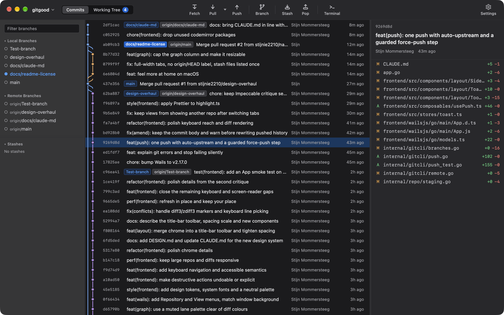
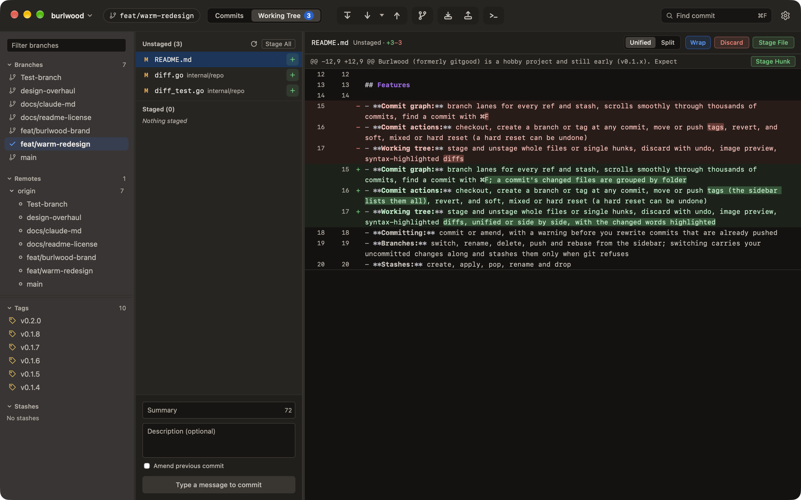

<p align="center">
  
</p>

<h1 align="center">gitgood</h1>

A fast desktop Git client, built first for macOS. One native binary made with [Wails](https://wails.io): a Go backend and a Vue 3 frontend, no Electron and no local web server.

gitgood is a hobby project and still early (v0.1.x). Expect rough edges, and keep your usual backups of anything precious.



## Features

- **Commit graph:** branch lanes for every ref and stash, scrolls smoothly through thousands of commits, find a commit with ⌘F
- **Commit actions:** checkout, create a branch or tag at any commit, move or push tags, revert, and soft, mixed or hard reset (a hard reset can be undone)
- **Working tree:** stage and unstage whole files or single hunks, discard with undo, image preview, syntax-highlighted diffs
- **Committing:** commit or amend, with a warning before you rewrite commits that are already pushed
- **Branches:** switch, rename, delete, push and rebase from the sidebar; switching carries your uncommitted changes along and stashes them only when git refuses
- **Stashes:** create, apply, pop, rename and drop
- **Merge and rebase conflicts:** pick ours or theirs per conflict, with diff3/zdiff3 support and a banner showing rebase progress
- **Remotes:** fetch (also automatically in the background), pull with your preferred mode and automatic stashing, push with automatic upstream, and force push with lease when a push is rejected
- **Clear errors:** git's error output is turned into a plain sentence with a next step; the full output stays one click away
- **Tabs:** several repositories open at once, restored on the next launch

Not supported yet: HTTPS authentication for private repositories. SSH remotes work through your SSH agent.



## Installing

Download the latest build from [Releases](https://github.com/stijnie2210/gitgood/releases).

gitgood calls the `git` on your system for most operations, so git must be installed and on your `PATH`.

### macOS

Open `gitgood-mac-universal.dmg` and drag gitgood to Applications. The app isn't signed with an Apple Developer ID, so macOS blocks it on the first launch. Clear the quarantine flag once:

```bash
xattr -dr com.apple.quarantine /Applications/gitgood.app
```

### Linux

The AppImage needs WebKit2GTK 4.1:

```bash
# Fedora / RHEL
sudo dnf install webkit2gtk4.1

# Ubuntu / Debian
sudo apt install libwebkit2gtk-4.1-0

# Arch Linux
sudo pacman -S webkit2gtk-4.1
```

Then make it executable and run it:

```bash
chmod +x gitgood-linux-amd64.AppImage
./gitgood-linux-amd64.AppImage
```

### Windows

Unzip `gitgood-windows-amd64.zip` and run `gitgood.exe`.

## Building from source

Requirements:

- Go 1.25+
- Node.js 20.19+ or 22.12+
- [Wails CLI](https://wails.io/docs/gettingstarted/installation) v2

```bash
wails dev        # development build with hot reload
wails build      # production build → build/bin/
```

Tests and checks:

```bash
go test ./internal/...
cd frontend && npm test && npm run lint && npm run build
```

## How it works

The Go side runs your system `git` for almost everything and parses its output; `internal/gitcli/` holds the thin command wrappers and `internal/repo/` the logic on top. The commit graph layout lives in `internal/graph/`. The Vue frontend (`frontend/src/`) calls the Go methods through bindings that Wails generates. For hunk staging, the frontend builds the patch from exactly the lines on screen and hands it to `git apply --cached`.

[CLAUDE.md](CLAUDE.md) has the detailed architecture notes and a file map.

## License

Copyright © 2026 Stijn Mommersteeg

gitgood is free software: you can redistribute it and/or modify it under the terms of the [GNU General Public License v3.0](LICENSE). If you distribute a modified version, it must also be released under the GPL with its source code.
