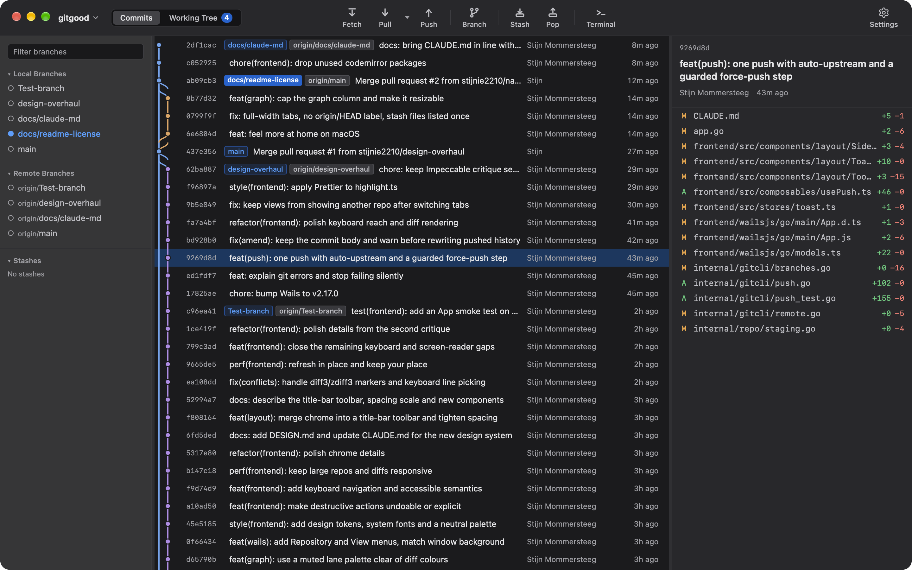
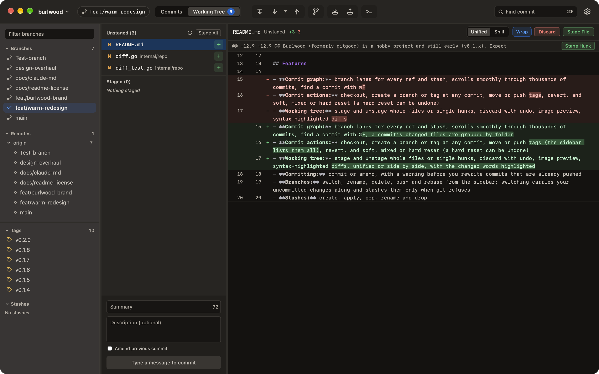

<p align="center">
  
</p>

<h1 align="center">Burlwood</h1>

A fast desktop Git client, built first for macOS. One native binary made with [Wails](https://wails.io): a Go backend and a Vue 3 frontend, no Electron and no local web server.

Burlwood (formerly gitgood) is free and open source.



## Features

- **Commit graph:** branch lanes for every ref and stash, scrolls smoothly through thousands of commits, find a commit with ⌘F; a commit's changed files are grouped by folder
- **Commit actions:** checkout, cherry-pick onto the current branch, create a branch or tag at any commit, revert, copy the message, and soft, mixed or hard reset (a hard reset can be undone)
- **Interactive rebase:** pick, reword, squash, fix up, drop and reorder commits in an editor that says what each step will do and warns before it rewrites pushed commits; a finished rebase can be undone
- **File history and blame:** every commit that changed a file, across renames, with that commit's diff; blame shows the commit behind each line, at the working tree or at any commit
- **Tags:** the sidebar lists them all; move, push or delete a tag, also from origin, with undo
- **Working tree:** stage and unstage whole files or single hunks, discard a file, a single hunk or everything unstaged, with undo, image preview, syntax-highlighted diffs, unified or side by side, with the changed words highlighted
- **Committing:** commit or amend, with a warning before you rewrite commits that are already pushed
- **Branches:** switch, rename, delete (with undo), push, set upstream, merge into the current branch and rebase from the sidebar; delete a branch from its remote, with undo; rebase warns before it rewrites commits you already pushed; checking out a remote branch reuses your local one and fast-forwards it when it's behind; switching carries your uncommitted changes along and stashes them only when git refuses
- **Worktrees:** the sidebar lists a repository's linked worktrees; open one as a tab or in Finder, your terminal or your editor, remove it (with an extra step when it has uncommitted changes) or prune it once its folder is gone; a branch checked out in another worktree names that worktree, and double-clicking it opens the worktree
- **Stashes:** create (optionally with untracked files), apply, pop, rename and drop
- **Conflicts:** after a merge, cherry-pick, revert or rebase, pick ours or theirs per conflict, with diff3/zdiff3 support; a banner names the operation (and shows rebase progress) and aborts it
- **Remotes:** fetch (also automatically in the background), pull with your preferred mode and automatic stashing, push with automatic upstream, and force push with lease when a push is rejected; fetch or prune a single remote, and optionally prune on every fetch
- **Clear errors:** git's error output is turned into a plain sentence with a next step; the full output stays one click away
- **Tabs:** several repositories open at once, restored on the next launch
- **Keyboard:** menu-bar shortcuts for fetch, pull, push, stash and new branch, and ⌘Enter to commit

Not supported yet: HTTPS authentication for private repositories. SSH remotes work through your SSH agent.



## Installing

Download the latest build from [Releases](https://github.com/stijnie2210/burlwood/releases).

Burlwood calls the `git` on your system for most operations, so git must be installed and on your `PATH`.

### macOS

Burlwood needs macOS 12 (Monterey) or newer. Open `burlwood-mac-universal.dmg` and drag Burlwood to Applications. The app isn't signed with an Apple Developer ID, so macOS blocks it on the first launch. Clear the quarantine flag once:

```bash
xattr -dr com.apple.quarantine /Applications/Burlwood.app
```

### Linux

The AppImage needs GTK 4 and WebKitGTK 6.0 (Ubuntu 24.04, Debian 13, Fedora 40 or newer):

```bash
# Fedora / RHEL
sudo dnf install webkitgtk6.0

# Ubuntu / Debian
sudo apt install libwebkitgtk-6.0-4

# Arch Linux
sudo pacman -S webkitgtk-6.0
```

Then make it executable and run it:

```bash
chmod +x burlwood-linux-amd64.AppImage
./burlwood-linux-amd64.AppImage
```

On an ARM64 machine, use `burlwood-linux-arm64.AppImage` instead.

### Windows

Unzip `burlwood-windows-amd64.zip` and run `burlwood.exe`. The app isn't signed, so SmartScreen may stop the first launch with "Windows protected your PC". Choose **More info**, then **Run anyway**.

## Building from source

Requirements:

- Go 1.27.3+ (the October 2026 security release)
- Node.js 22.23.4+ or 24.22.1+ (the October 2026 security releases)
- [Wails CLI](https://v3.wails.io/getting-started/installation/) v3.0, the version `go.mod` pins: `go install github.com/wailsapp/wails/v3/cmd/wails3@v3.0.0`
- On Linux: gcc and the GTK 4 / WebKitGTK 6.0 headers (`sudo apt install build-essential libgtk-4-dev libwebkitgtk-6.0-dev`)

```bash
wails3 dev                           # development build with hot reload
wails3 build                         # production binary → bin/
wails3 task darwin:package           # macOS: bin/Burlwood.app
wails3 task windows:build ARCH=amd64 # Windows, also from macOS or Linux: bin/burlwood.exe
```

Tests and checks:

```bash
go test ./internal/...
cd frontend && npm test && npm run lint && npm run build
```

## How it works

The Go side runs your system `git` for almost everything and parses its output; `internal/gitcli/` holds the thin command wrappers and `internal/repo/` the logic on top. The commit graph layout lives in `internal/graph/`. The Vue frontend (`frontend/src/`) calls the Go methods through bindings that Wails generates. For hunk staging, the frontend builds the patch from exactly the lines on screen and hands it to `git apply --cached`.

[CLAUDE.md](CLAUDE.md) has the detailed architecture notes and a file map.

## License

Copyright © 2026 Stijn Mommersteeg

Burlwood is free software: you can redistribute it and/or modify it under the terms of the [GNU General Public License v3.0](LICENSE). If you distribute a modified version, it must also be released under the GPL with its source code.
